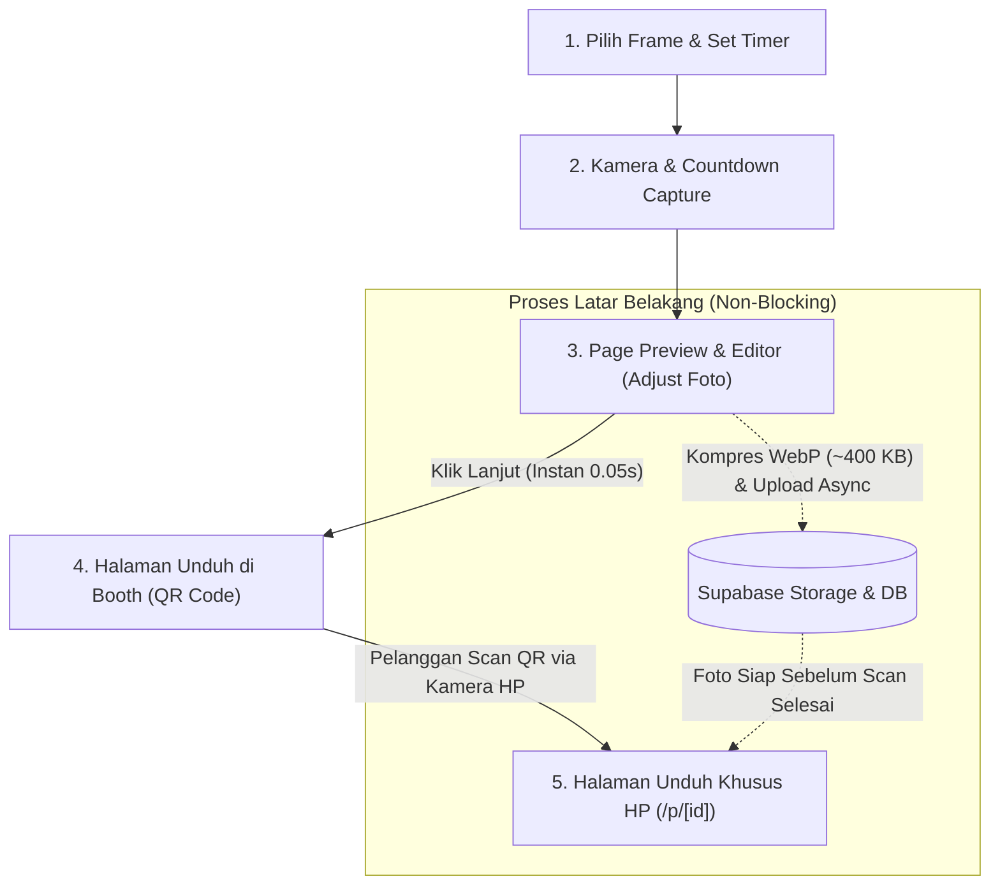

# Blueprint & Workflow Renovasi Arsitektur Skytive Photobooth

Dokumen ini merangkum seluruh perencanaan arsitektur baru, alur pengguna (user flow), strategi optimasi performa tanpa delay, dan mekanisme pembersihan otomatis harian untuk sistem **Skytive Photobooth Online**.

---

## 1. Latar Belakang & Masalah Sistem Lama

| Aspek | Sistem Lama (Sebelum Renovasi) | Masalah yang Terjadi |
| :--- | :--- | :--- |
| **Penyimpanan Foto** | Memori RAM Server (`globalThis._photosStoreMap`) & `localStorage` browser. | Foto hilang jika server restart/deploy serverless (Vercel). Foto tidak bisa diakses lintas perangkat dengan andal. |
| **Ukuran Data** | Raw Base64 PNG (600x1800 px) ~3 MB – 6 MB per foto. | Payload sangat besar untuk dikirim lewat jaringan venue/tethering HP. |
| **Respon QR Code** | *Blocking Upload*: Menunggu proses `await fetch('/api/photos')` selesai baru membuka halaman unduh. | Layar booth mengalami jeda/delay loading berputar selama 3–8 detik sebelum QR code muncul. |
| **Manajemen Disk** | Penyimpanan manual / in-memory FIFO 50 foto. | Berpotensi memory leak atau memenuhi kuota jika berpindah ke cloud storage tanpa sistem rotasi. |

---

## 2. Alur Pengguna (Core User Flow)

Alur pengguna utama **tetap dipertahankan 100%** sesuai kebutuhan photobooth profesional:



### Penjelasan Setiap Tahap:
1. **Langkah 1: Setup Sesi**
   - Pelanggan memilih desain frame awal dan durasi timer countdown.
2. **Langkah 2: Sesi Foto (Capture)**
   - Booth mengambil 3 atau 4 foto secara berurutan dengan feedback audio/visual.
3. **Langkah 3: Page Preview & Editor (Wajib Dipertahankan)**
   - Pelanggan leluasa menyesuaikan foto: zoom in/out, geser koordinat (drag), dan memilih warna frame pendukung.
4. **Langkah 4: Halaman Unduh Booth (QR Code Instant)**
   - Begitu tombol **"Lanjut / Cetak"** diklik, layar booth **langsung berpindah ke Halaman Unduh dalam 0.05 detik**.
   - QR Code langsung ditampilkan seketika (menggunakan ID sesi yang di-generate lokal).
5. **Langkah 5: Halaman Khusus Mobile (`/p/[id]`)**
   - Pelanggan memindai QR Code dengan HP.
   - Halaman responsif terbuka di browser HP pelanggan dengan tombol *"Simpan ke Galeri (PNG/WebP)"*.

---

## 3. Strategi "Zero-Delay QR Code" (Tanpa Loading Muter)

Untuk menghilangkan jeda saat berpindah dari Halaman Preview ke Halaman Unduh:

```
[Layar Editor] ---> [Klik Lanjut] ---> [Layar QR Code Langsung Tampil]
                                                  │
                                                  ▼ (Di latar belakang)
                                      [Kompresi Canvas WebP 400KB]
                                                  │
                                                  ▼ (0.3 - 0.5 detik)
                                        [Upload ke Cloud Storage]
```

1. **Optimistic UI (ID Lokal Instan)**
   - Sesi foto membuat ID unik instan di browser booth: `photoId = 'sky-' + Date.now().toString(36)`.
   - URL download sudah pasti: `https://domain.com/p/${photoId}`.
   - QR code langsung digambar di canvas/SVG booth tanpa menunggu konfirmasi server.
2. **Background Upload (Non-Blocking Promise)**
   - Pemanggilan API upload tidak lagi menggunakan `await` yang memblokir navigasi UI.
   - Layar booth berpindah secara mulus ke Halaman QR, sementara proses upload berjalan di *background thread*.
   - *Fakta UX:* Pelanggan butuh 4–7 detik untuk mengambil HP, membuka kamera, dan membidik QR. Dalam rentang waktu ini, proses upload di background sudah selesai 100%.
3. **Kompresi Canvas ke WebP (Kualitas 0.85)**
   - Canvas strip diekspor menggunakan format `image/webp` dengan kualitas `0.85`.
   - Ukuran file turun **85%** (dari ~4 MB menjadi ~350–500 KB) tanpa penurunan ketajaman visual untuk dicetak atau disimpan di HP.

---

## 4. Arsitektur Penyimpanan: Supabase (Storage + Database)

Mengapa memilih **Supabase**?
- **100% Gratis & Tanpa Kartu Kredit:** Cukup login menggunakan akun GitHub (`Dandyskie`).
- **Free Tier Melimpah:** Gratis **1 GB Object Storage** + **500 MB PostgreSQL Database**.
- **Kapasitas Nyata:** Dengan ukuran foto ~400 KB, kuota 1 GB dapat menampung **~2.500 foto**. Dengan auto-delete harian, kuota ini tidak akan pernah habis.

### Skema Database Metadata (`photos`)
```sql
create table public.photos (
  id text primary key,
  storage_path text not null,
  public_url text not null,
  frame_id text,
  created_at timestamp with time zone default timezone('utc'::text, now()) not null
);
```

---

## 5. Mekanisme Pembersihan Otomatis Harian (Daily Auto-Delete)

Agar penyimpanan Supabase tetap bersih, tidak boros kuota, dan menjaga privasi foto pelanggan:

### Metode: Scheduled Cron Cleanup (`/api/cron/cleanup`)

1. **Endpoint API Next.js (`src/app/api/cron/cleanup/route.ts`)**
   - Mengambil daftar file foto yang berumur lebih dari 24 jam (`created_at < NOW() - INTERVAL '24 hours'`).
   - Menghapus batch file dari Supabase Storage:
     ```typescript
     await supabase.storage.from('photos').remove(oldPhotoPaths);
     ```
   - Menghapus record metadata terkait di tabel database.
2. **Penjadwalan Otomatis (Tiap Jam 00:00)**
   - **Jika di-deploy ke Vercel:** Gunakan fitur bawaan `vercel.json`:
     ```json
     {
       "crons": [
         {
           "path": "/api/cron/cleanup",
           "schedule": "0 0 * * *"
         }
       ]
     }
     ```
   - **Jika dijalankan mandiri / Localhost / Server sendiri:** Gunakan cron external gratis seperti [cron-job.org](https://cron-job.org) untuk memanggil webhook URL tersebut setiap tengah malam.

---

## 6. Roadmap & Checklist Implementasi

### Fase 1: Pemisahan Git & Inisialisasi Baru
- [ ] Reset Git lama (`rm -rf .git`) dan inisialisasi fresh (`git init`).
- [ ] Buat repository baru di GitHub (misal: `skytive-photobooth`).
- [ ] Push commit awal (*Initial commit: Skytive Photobooth*).

### Fase 2: Setup Supabase
- [ ] Login ke [supabase.com](https://supabase.com) via GitHub.
- [ ] Buat project baru: `skytive-photobooth`.
- [ ] Buat Public Bucket di Storage: `photos`.
- [ ] Salin `SUPABASE_URL` dan `SUPABASE_ANON_KEY` ke file `.env.local`.

### Fase 3: Integrasi Backend & Upload Non-Blocking
- [ ] Install SDK: `npm install @supabase/supabase-js`.
- [ ] Buat client helper di `src/lib/supabase.ts`.
- [ ] Update `PhotoEditor.tsx` agar menggunakan konversi canvas WebP dan navigasi optimistik (tanpa delay).
- [ ] Update Halaman Download Pelanggan (`src/app/p/[id]/page.tsx`) untuk mengambil data foto dari Supabase CDN.

### Fase 4: Otomatisasi Auto-Delete
- [ ] Buat endpoint `src/app/api/cron/cleanup/route.ts`.
- [ ] Konfigurasi cron trigger harian (Vercel Cron / cron-job.org).
- [ ] Uji coba flow lengkap: Foto $\rightarrow$ Preview/Adjust $\rightarrow$ Instant QR $\rightarrow$ Scan HP $\rightarrow$ Auto-Delete.
