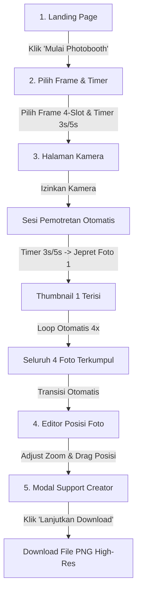
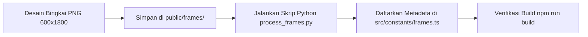

# 📸 Dyskie Creative — Workflow & System Architecture Guide

> Dokumentasi Lengkap Alur Sistem, Tech Stack, Alasan Pemilihan Teknologi, Fungsi Utama, dan Syntax Kunci Aplikasi Online Photobooth Dyskie Creative.

---

## 📋 Daftar Isi
1. [Overview Sistem](#1-overview-sistem)
2. [Tech Stack & Alasan Pemilihan Teknologi](#2-tech-stack--alasan-pemilihan-teknologi)
3. [Alur Sistem dari Sisi User (User Workflow)](#3-alur-sistem-dari-sisi-user-user-workflow)
4. [Alur Sistem dari Sisi Admin & Maintenance (Admin Workflow)](#4-alur-sistem-dari-sisi-admin--maintenance-admin-workflow)
5. [Fungsi-Fungsi Utama & Syntax Kunci (Technical Deep Dive)](#5-fungsi-fungsi-utama--syntax-kunci-technical-deep-dive)
6. [Prinsip Keamanan & Performa](#6-prinsip-keamanan--performa)

---

## 1. Overview Sistem

**Dyskie Creative** adalah aplikasi **Online Photobooth modern berbasis web** dengan estetika visual *Korean Y2K Studio* (Soft Rosé Pink `#FF85A1`, Dreamy Lavender `#B892FF`, Cyber Sky `#70D6FF`). 

Aplikasi ini memungkinkan pengguna untuk:
1. Memilih desain bingkai (4 Slot foto) dan timer hitung mundur.
2. Membuka kamera laptop/smartphone secara langsung di browser tanpa instalasi aplikasi.
3. Melakukan sesi pemotretan beruntun (4 foto) secara otomatis dengan alur timer presisi.
4. Memilih, menggeser (*drag/pan*), dan memperbesar (*zoom*) posisi foto pada masing-masing slot bingkai.
5. Mengunduh hasil foto akhir berupa gambar PNG beresolusi tinggi (`600px × 1800px`) secara gratis dan instan.

 Seluruh alur kerja diproses **100% Client-Side** di browser pengguna demi privasi, kecepatan eksekusi, dan biaya server minimum.

---

## 2. Tech Stack & Alasan Pemilihan Teknologi

Berikut adalah daftar teknologi yang digunakan dalam proyek ini beserta alasan kuat di balik penggunaannya:

### 1. **Next.js 15 (App Router)**
- **Alasan Penggunaan**: Next.js memberikan struktur aplikasi web modern yang sangat cepat dengan dukungan *Server Components* untuk landing page (SEO optimal) dan *Client Components* untuk fitur interaktif kamera & editor.
- **Keunggulan**: Routing berbasis file yang rapi, optimasi gambar otomatis (`next/image`), dan kemudahan *deployment* ke Vercel/Netlify.

### 2. **TypeScript**
- **Alasan Penggunaan**: Menyediakan *static type-checking* untuk mencegah bug runtime, terutama saat menangani struktur metadata bingkai, koordinat slot, dan state array foto.
- **Keunggulan**: Menjamin kecocokan tipe data antara `FrameMetadata`, `PhotoSlotPosition`, dan parameter fungsi Canvas Exporter.

### 3. **Zustand (Global State Management)**
- **Alasan Penggunaan**: Jauh lebih ringan, cepat, dan sederhana dibandingkan Redux. Zustand tidak memerlukan *boilerplate code* (reducers/actions) yang rumit.
- **Keunggulan**: Memudahkan perpindahan tahapan aplikasi (`landing` ➔ `frame-select` ➔ `camera` ➔ `editor` ➔ `download`) serta membagi state foto terambil ke seluruh komponen secara konsisten tanpa *prop drilling*.

### 4. **HTML5 MediaDevices API (`navigator.mediaDevices.getUserMedia`)**
- **Alasan Penggunaan**: API standar industri browser untuk mengakses perangkat kamera (webcam) secara langsung tanpa perantara plugin atau pihak ketiga.
- **Keunggulan**: Mendukung pengaturan resolusi ideal (`1280x720`), kontrol pause/resume stream video, dan performa *real-time video preview* berkecepatan tinggi (60 FPS).

### 5. **HTML5 Canvas API (High-Resolution Overlay Exporter)**
- **Alasan Penggunaan**: Memungkinkan manipulasi gambar tingkat rendah (clipping mask rounded corner, scaling, image composition, dan ekspor PNG) langsung di memori browser.
- **Keunggulan**: Mampu menghasilkan file gambar PNG resolusi tinggi `600px × 1800px` yang sangat tajam tanpa bergantung pada backend server.

### 6. **Tailwind CSS v4 + Vanilla CSS Variables**
- **Alasan Penggunaan**: Utility-first CSS framework versi terbaru yang sangat cepat dengan dukungan custom design tokens (Y2K color palettes, radial aura gradients, glossy glassmorphism, dan custom shadow).
- **Keunggulan**: Tidak membebankan ukuran bundle aplikasi, responsif di layar smartphone maupun desktop.

### 7. **Framer Motion**
- **Alasan Penggunaan**: Library animasi standar untuk React guna menciptakan transisi UI yang fluid (efek kilat flash kamera, animasi angka countdown 3-2-1, dan hover mikro-interaksi tombol).
- **Keunggulan**: Sintaks animasi declarative yang mudah dibaca dan performa berbasis GPU acceleration.

### 8. **Python Pillow (Skrip Otomasi Asset Admin)**
- **Alasan Penggunaan**: Dipakai dari sisi admin/developer untuk melubangi transparansi piksel pada file gambar bingkai (`Frame-1.png`, `Frame-2.png`, `Frame-3.png`).
- **Keunggulan**: Mengonversi gambar solid RGB menjadi RGBA transparan secara otomatis dan presisi tanpa perlu mengedit manual satu per satu di software grafis.

---

## 3. Alur Sistem dari Sisi User (User Workflow)



### Detail Langkah User:

1. **Langkah 1: Landing Page (`LandingSection.tsx`)**
   - User tiba di halaman utama Dyskie Creative.
   - User membaca keunggulan fitur (Gratis, Tanpa Login, Hasil High-Res).
   - User menekan tombol utama **"Mulai Photobooth"**.

2. **Langkah 2: Pemilihan Bingkai & Timer (`FrameSelector.tsx`)**
   - User memilih salah satu dari template bingkai favorit (misal: *Y2K Pink Dream*, *Korean Lavender*, atau *Sky Sparkle*).
   - User memilih opsi durasi timer hitung mundur: **3 Detik** atau **5 Detik**.
   - User menekan tombol **"Lanjut ke Kamera"**.

3. **Langkah 3: Sesi Pemotretan Kamera (`CameraView.tsx`)**
   - Browser meminta izin akses kamera pengguna.
   - Kamera menampilkan live preview beresolusi tinggi dengan efek cermin (mirror).
   - User dapat menekan tombol **"Pause Kamera"** jika ingin bersiap-siap.
   - User menekan **"Mulai Capture (4 Foto)"**:
     - Hitung mundur dimulai (3 ➔ 2 ➔ 1 ➔ 📸).
     - Efek kilat putih flash kamera menyala 200ms.
     - Foto snapshot tersimpan ke slot thumbnail 1 dengan indikator centang (`✓`).
     - Sistem memberi jeda 800ms, lalu otomatis mengulang hitung mundur untuk foto ke-2, ke-3, dan ke-4.
     - Setelah 4 foto selesai, sistem memberi jeda 600ms lalu otomatis pindah ke Editor.

4. **Langkah 4: Editor Posisi Foto (`PhotoEditor.tsx`)**
   - User melihat pratinjau bingkai hasil akhir berasio `1:3`.
   - User dapat memilih Slot 1, 2, 3, atau 4.
   - User dapat mengatur **Zoom (80% - 250%)** dan menggeser posisi foto (**▲ ▼ ◄ ►**) agar wajah pas di tengah bingkai.

5. **Langkah 5: Unduh Hasil Foto (`DownloadSection.tsx` & `SupportModal.tsx`)**
   - User menekan tombol **"Selesai & Unduh PNG"**.
   - Pop-up modal *Support Creator* muncul (mengajak follow Instagram).
   - User menekan **"Lanjutkan Download"**.
   - Canvas Renderer menggabungkan foto + overlay bingkai menjadi file PNG asli `600px × 1800px` dan terunduh otomatis ke folder Download laptop/HP user.

---
r: 3sr: 3s

Pause Kamera

Batal


Pause Kamera

Batal

## 4. Alur Sistem dari Sisi Admin & Maintenance (Admin Workflow)

Sebagai Admin atau Developer aplikasi Dyskie Creative, berikut alur kerja untuk mengelola dan menambahkan desain bingkai baru:



### Detail Langkah Admin:

1. **Menyiapkan Asset Bingkai (`public/frames/`)**:
   - Ukuran gambar standar bingkai adalah **`600px` (Lebar) × `1800px` (Tinggi)** dengan rasio `1 : 3`.
   - Simpan file gambar di folder `photobooth/public/frames/Frame-N.png`.

2. **Memastikan Transparansi Slot Bingkai (Python Pillow Automation)**:
   - File bingkai **WAJIB memiliki area transparan (Alpha Channel)** pada lokasi 4 slot foto agar hasil foto pengguna terlihat menembus dari belakang.
   - Jika file dari desainer masih berupa gambar solid (misal background slot masih putih), jalankan skrip Python pemroses transparansi:
     ```bash
     python3 scratch/process_frames.py
     ```
   - Skrip ini akan secara otomatis mengubah warna putih di area slot foto menjadi piksel transparan `RGBA(0, 0, 0, 0)`.

3. **Mendaftarkan Metadata Bingkai Baru (`src/constants/frames.ts`)**:
   - Tambahkan objek metadata baru pada array `FRAMES`:
     ```typescript
     {
       id: "frame-4",
       name: "Cyber Neon Y2K",
       thumbnail: "/frames/Frame-4.png",
       frameImage: "/frames/Frame-4.png",
       photoCount: 4,
       width: 600,
       height: 1800,
       backgroundColor: "#FFF0F6",
       accentColor: "#FF85A1",
       slots: [
         { id: 0, x: 40, y: 50, width: 520, height: 380, borderRadius: 16 },
         { id: 1, x: 40, y: 460, width: 520, height: 380, borderRadius: 16 },
         { id: 2, x: 40, y: 870, width: 520, height: 380, borderRadius: 16 },
         { id: 3, x: 40, y: 1280, width: 520, height: 380, borderRadius: 16 },
       ],
     }
     ```

4. **Verifikasi Build**:
   - Jalankan perintah build untuk memastikan tidak ada kesalahan tipe data TypeScript:
     ```bash
     npm run build
     ```

---

## 5. Fungsi-Fungsi Utama & Syntax Kunci (Technical Deep Dive)

Berikut adalah bedah kode teknis dari fungsi-fungsi paling krusial di dalam codebase:

### 🛠️ Syntax 1: Custom Camera Hook (`src/hooks/useCamera.ts`)
*Fungsi: Menginisialisasi stream kamera browser, mengendalikan pause/resume, dan menangkap gambar ke canvas DataURL.*

```typescript
// Initialisasi Stream Kamera via MediaDevices API
const startCamera = useCallback(async () => {
  setError(null);
  try {
    const mediaStream = await navigator.mediaDevices.getUserMedia({
      video: {
        width: { ideal: 1280 },
        height: { ideal: 720 },
        facingMode: "user", // Menggunakan kamera depan
      },
      audio: false,
    });

    setStream(mediaStream);
    setIsCameraActive(true);

    if (videoRef.current) {
      videoRef.current.srcObject = mediaStream;
      videoRef.current.play().catch((err: Error) => {
        // Silent catch untuk menangani AbortError jika stream berubah cepat
        if (err.name !== "AbortError") {
          console.error("Camera play error:", err);
        }
      });
    }
  } catch (err: unknown) {
    setError("Izin kamera diperlukan untuk melanjutkan photobooth.");
  }
}, []);

// Pengambilan Snapshot Foto (Fungsi capturePhoto)
const capturePhoto = useCallback((): string | null => {
  if (!videoRef.current) return null;

  const video = videoRef.current;
  const width = video.videoWidth || 1280;
  const height = video.videoHeight || 720;

  const canvas = document.createElement("canvas");
  canvas.width = width;
  canvas.height = height;

  const ctx = canvas.getContext("2d");
  if (!ctx) return null;

  // Efek cermin (Mirror Horizontal) agar hasil potret sesuai tampilan live view
  ctx.translate(canvas.width, 0);
  ctx.scale(-1, 1);
  ctx.drawImage(video, 0, 0, canvas.width, canvas.height);

  return canvas.toDataURL("image/png");
}, []);
```
**Mengapa Syntax Ini Digunakan?**
- `facingMode: "user"` memastikan kamera depan pada smartphone aktif secara otomatis.
- `ctx.scale(-1, 1)` membalikkan gambar secara horizontal agar hasil foto tidak terbalik dari sudut pandang pengguna.

---

### 🛠️ Syntax 2: Deterministic Async Capture Loop (`src/features/camera/CameraView.tsx`)
*Fungsi: Menjalankan alur pemotretan otomatis 4 foto tanpa terkena bug stale closures React.*

```typescript
// Isolasi Lifecycle Mount Kamera agar tidak unmount saat re-render
useEffect(() => {
  isSequenceActiveRef.current = false;
  setPhotos([]);
  setIsSequenceActive(false);

  startCameraRef.current();

  return () => {
    isSequenceActiveRef.current = false;
    stopCameraRef.current();
  };
}, [setPhotos]); // Empty/Stable dependency array

// Async Sequence Loop 4 Foto
const startSession = async () => {
  if (isPaused) resumeCamera();

  isSequenceActiveRef.current = true;
  setIsSequenceActive(true);
  setPhotos([]);

  const total = selectedFrame.photoCount;
  const accumulatedPhotos: string[] = [];

  for (let slot = 0; slot < total; slot++) {
    if (!isSequenceActiveRef.current) break;

    // 1. Loop Timer Countdown (e.g. 3, 2, 1)
    for (let sec = selectedTimer; sec > 0; sec--) {
      if (!isSequenceActiveRef.current) break;
      setCountdown(sec);
      await sleep(1000);
    }

    if (!isSequenceActiveRef.current) break;

    // 2. Countdown 0 -> Jepret Foto
    setCountdown(0);
    const photoData = capturePhoto();
    if (photoData) {
      setShowFlash(true);
      setTimeout(() => setShowFlash(false), 200);

      accumulatedPhotos.push(photoData);
      setPhotos([...accumulatedPhotos]);
    }

    // 3. Jeda singkat sebelum foto berikutnya
    if (slot < total - 1) {
      await sleep(800);
    }
  }

  // 4. Selesai -> Pindah ke Editor
  if (isSequenceActiveRef.current) {
    setCountdown(null);
    await sleep(600);
    setIsSequenceActive(false);
    isSequenceActiveRef.current = false;
    stopCameraRef.current();
    setStep("editor");
  }
};
```
**Mengapa Syntax Ini Digunakan?**
- Menggunakan `async/await` dengan `for` loop lokal daripada `useEffect` timer callback. Ini **100% menjamin** 4 foto diambil secara pasti tanpa pernah terhenti di foto ke-1.
- `isSequenceActiveRef.current` berfungsi sebagai *abort flag* untuk membatalkan loop dengan cepat jika user menekan tombol Batal.

---

### 🛠️ Syntax 3: High-Res PNG Canvas Exporter (`src/lib/canvasExporter.ts`)
*Fungsi: Menggabungkan foto pengguna (dengan clipping rounded corner, zoom & offset) lalu menimpanya dengan overlay bingkai PNG 600x1800.*

```typescript
export async function generateHighResPNG(
  frame: FrameMetadata,
  photos: string[],
  positions: Record<number, PhotoSlotPosition>
): Promise<string> {
  const canvas = document.createElement("canvas");
  canvas.width = frame.width;  // 600px
  canvas.height = frame.height; // 1800px
  const ctx = canvas.getContext("2d");

  if (!ctx) throw new Error("Could not create canvas context");

  // 1. Warna Latar Belakang Dasar
  ctx.fillStyle = frame.backgroundColor || "#FFF0F6";
  ctx.fillRect(0, 0, frame.width, frame.height);

  // Helper pemuat gambar
  const loadImage = (src: string): Promise<HTMLImageElement> => {
    return new Promise((resolve, reject) => {
      const img = new Image();
      img.crossOrigin = "anonymous";
      img.onload = () => resolve(img);
      img.onerror = reject;
      img.src = src;
    });
  };

  // 2. Render Setiap Foto ke Dalam Slot Masing-masing
  for (let i = 0; i < frame.slots.length; i++) {
    const slot = frame.slots[i];
    const photoUrl = photos[i];
    if (!photoUrl) continue;

    const photoImg = await loadImage(photoUrl);
    const pos = positions[i] || { x: 0, y: 0, scale: 1 };

    ctx.save();
    ctx.beginPath();
    
    // Clipping Area Slot Foto (Rounded Corners)
    if (slot.borderRadius) {
      const r = slot.borderRadius;
      ctx.moveTo(slot.x + r, slot.y);
      ctx.arcTo(slot.x + slot.width, slot.y, slot.x + slot.width, slot.y + slot.height, r);
      ctx.arcTo(slot.x + slot.width, slot.y + slot.height, slot.x, slot.y + slot.height, r);
      ctx.arcTo(slot.x, slot.y + slot.height, slot.x, slot.y, r);
      ctx.arcTo(slot.x, slot.y, slot.x + slot.width, slot.y, r);
    } else {
      ctx.rect(slot.x, slot.y, slot.width, slot.height);
    }
    ctx.closePath();
    ctx.clip(); // Kunci gambar hanya di dalam slot

    // Hitung Skala Aspect Ratio Cover & Transformasi User (Zoom/Pan)
    const scaleCover = Math.max(
      slot.width / photoImg.width,
      slot.height / photoImg.height
    );

    const baseWidth = photoImg.width * scaleCover;
    const baseHeight = photoImg.height * scaleCover;

    const finalWidth = baseWidth * pos.scale;
    const finalHeight = baseHeight * pos.scale;

    const centerX = slot.x + slot.width / 2 + pos.x;
    const centerY = slot.y + slot.height / 2 + pos.y;

    const drawX = centerX - finalWidth / 2;
    const drawY = centerY - finalHeight / 2;

    ctx.drawImage(photoImg, drawX, drawY, finalWidth, finalHeight);
    ctx.restore();
  }

  // 3. Timpa Overlay Bingkai PNG Transparan di Lapisan Teratas
  try {
    const frameOverlayImg = await loadImage(frame.frameImage);
    ctx.drawImage(frameOverlayImg, 0, 0, frame.width, frame.height);
  } catch (err) {
    console.error("Frame overlay load error:", err);
  }

  return canvas.toDataURL("image/png");
}
```
**Mengapa Syntax Ini Digunakan?**
- Memisahkan lapisan foto di *layer bawah* (`z-index` bawah) dan gambar bingkai di *layer atas* (`z-index` atas).
- `ctx.clip()` memastikan bagian foto yang digeser atau di-zoom tidak melenceng keluar dari area slot foto.

---

### 🛠️ Syntax 4: Python Frame Transparent Cutout Script (`scratch/process_frames.py`)
*Fungsi: Mengubah piksel putih solid di area slot bingkai menjadi transparansi RGBA 0%.*

```python
import os
from PIL import Image

frames_dir = "/home/dandy/DANDYSKIE ALL PROJECT/PHOTOBOOTH - ONLINE/photobooth/public/frames"
slots = [
    {"x": 40, "y": 50, "width": 520, "height": 380},
    {"x": 40, "y": 460, "width": 520, "height": 380},
    {"x": 40, "y": 870, "width": 520, "height": 380},
    {"x": 40, "y": 1280, "width": 520, "height": 380},
]

for filename in ["Frame-1.png", "Frame-2.png", "Frame-3.png"]:
    filepath = os.path.join(frames_dir, filename)
    if os.path.exists(filepath):
        img = Image.open(filepath).convert("RGBA")
        pixels = img.load()
        width, height = img.size

        # Loop setiap piksel di dalam koordinat slot foto
        for slot in slots:
            sx, sy, sw, sh = slot["x"], slot["y"], slot["width"], slot["height"]
            for x in range(sx, min(sx + sw, width)):
                for y in range(sy, min(sy + sh, height)):
                    r, g, b, a = pixels[x, y]
                    # Jika piksel berwarna putih/mendekati putih
                    if r > 220 and g > 220 and b > 220:
                        pixels[x, y] = (0, 0, 0, 0) # Ubah ke Transparan

        img.save(filepath, "PNG")
```

---

## 6. Prinsip Keamanan & Performa

1. **Privasi 100% Pengguna**:
   - Seluruh aliran video kamera dan foto hasil jepretan diproses secara lokal di RAM browser pengguna (`base64 DataURL`).
   - Tidak ada gambar yang diunggah ke server backend eksternal.

2. **Bebas Memori Leak**:
   - Setiap kali pemotretan dibatalkan atau pengguna berpindah halaman, trek kamera (`stream.getTracks().forEach(track => track.stop())`) dihentikan secara bersih untuk membebaskan hardware kamera & daya baterai laptop/HP.

3. **Performa Tinggi Tanpa Delay**:
   - Penggunaan skema *Client Component* Next.js hanya pada fitur kamera & editor memastikan landing page memuat dalam waktu kurang dari 1 detik.
